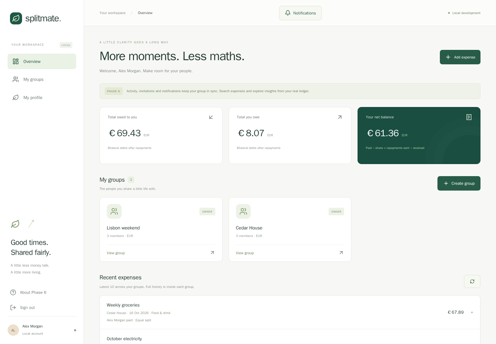
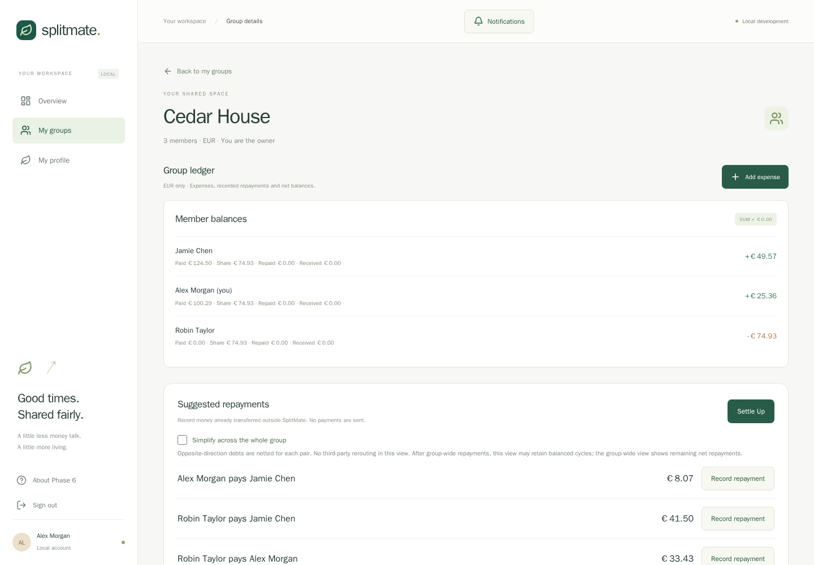
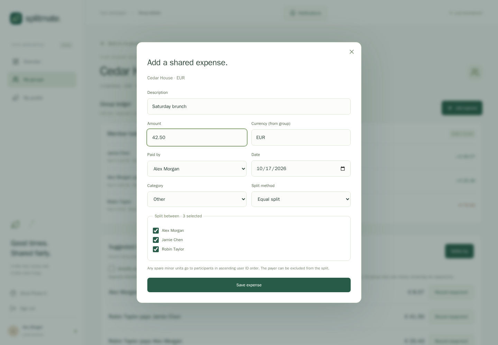
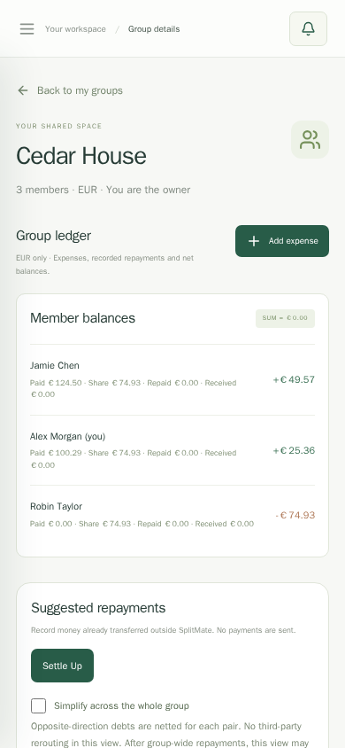

# SplitMate

A full-stack expense-sharing application with an original green-and-cream interface. SplitMate records shared expenses, preserves their allocations, calculates reproducible balances and records repayments without moving money.

**[Open the live demo](https://splitmate-fullstack.onrender.com)** · [Architecture](docs/architecture.md) · [API](docs/api.md) · [Deployment](docs/deployment.md)

The app runs on one Render Free Node.js service backed by Neon PostgreSQL. The owner verified desktop and mobile use. A read-only review on 17 October 2026 confirmed HTTP 200 for the homepage and PostgreSQL up through `/api/health`. The first visit after inactivity can take around a minute while the free service wakes. This is a portfolio demo, not a payment service or a production-readiness certification.

Use fictional information when trying the demo. No shared demo password or production account credentials are published.

## Features

- Registration, login and logout with PostgreSQL-backed sessions.
- Groups in EUR, GBP or USD, with invitations that registered users explicitly accept or decline.
- Expense creation and editing, payer/participant validation, and equal, exact-amount or percentage splits.
- Member balances, bilateral obligations and optional group-wide repayment suggestions.
- Partial/full repayment recording and audited reversals; no real payment processing.
- Expense search, date/category/payer filters, server-side pagination and URL-persisted filters.
- Append-only activity, in-app notifications and authenticated personal/group analytics.
- Responsive layouts, accessible dialogs and loading, empty and error states.

## Screenshots

These are actual application screenshots from a passing Playwright journey against an isolated local test database. Alex Morgan, Jamie Chen, Robin Taylor and every displayed expense are fictional fixtures. They are not captures of production users or a seeded public account. Local-development labels in the images reflect their capture environment. [Capture and privacy notes](docs/screenshots.md).

### Dashboard

### Group balances and repayments

### Expense entry

### Mobile

## Stack and architecture

| Layer | Implementation |
| --- | --- |
| Frontend | React 19, TypeScript, Vite, Tailwind CSS 4, Lucide icons |
| Backend | Node.js 22.23.3, Express 5, TypeScript |
| Database | PostgreSQL, Prisma 7.10.1, pg adapter, six versioned migrations |
| Tests | Vitest, Supertest, Playwright Chromium |
| Delivery | npm workspaces, Docker Compose locally, GitHub Actions, Render Free and Neon Free |

~~~mermaid
flowchart LR
  Browser[Desktop or mobile browser] -->|HTTPS / one origin| App[Render / Express]
  App --> Assets[Compiled React assets and SPA routes]
  App --> API[JSON API /api]
  API -->|Prisma / verified TLS / pooled URL| Neon[(Neon PostgreSQL)]
  Migration[Separately approved migrations] -->|Direct TLS URL| Neon
  CI[GitHub Actions] --> Tests[(Isolated temporary PostgreSQL)]
~~~

`apps/frontend` contains the React UI, exact decimal parsing and relative `/api` requests. `apps/backend` owns authentication, membership permissions, ledger calculations and migrations. Local Docker uses Vite plus Express and its own PostgreSQL volume; it is independent of Neon. In the cloud, Express serves built React and reserves API routes before the SPA fallback. Missing APIs/assets never become the HTML shell.

### Engineering decisions

| Decision | Reason and tradeoff |
| --- | --- |
| Integer minor units | Decimal inputs are parsed as digits; BigInt intermediates avoid fractional-money errors. No exchange rates or mixed-currency aggregation. |
| Deterministic splitting | Shares always total the expense. Equal-split remainder units go by ascending participant UUID; percentages use basis points and largest remainders with UUID tie-breaking. |
| Immutable financial history | Reversals retain repayment/audit records. Debt suggestions never rewrite original expense shares. Expense edits use versions to detect stale submissions. |
| Atomic mutations | Serializable transactions, row locks, idempotency keys, database constraints and deferred share-total checks protect concurrent ledger writes. Activity/notifications commit with mutations. |
| Server-side sessions | Random tokens are hashed in PostgreSQL; browser cookies are HttpOnly, Secure in HTTPS and SameSite=Strict. Sessions survive process replacement until expiry/revocation. |
| Same-origin deployment | One service avoids separate frontend/API origins. Writes require exact Origin, JSON and authenticated CSRF tokens; group authorization uses the signed-in user. |
| Separate generation/migrations | Building requires no database access. Runtime uses the pooled URL; approved migrations use a direct URL. Startup neither migrates nor seeds. |
| Separate test database | Tests reject non-test database names. Fictional browser fixtures never populate local user data or Neon. |

For example, 1001 minor units split equally across three UUID-ordered participants becomes **334, 334, 333**. Each group's balances must sum to zero:

**Net balance = paid − expense share + repayments sent − repayments received.**

Opposite-direction debts are netted per pair. Optional group-wide simplification greedily matches debtors to creditors while conserving every member's net balance. It does not guarantee the minimum number of transfers. [Financial algorithms](docs/financial-model.md) and [schema/constraints](docs/schema.md) describe the details.

## Run locally: Windows PowerShell

Install Git and Docker Desktop and start its Linux engine. Node/PostgreSQL are provided by Docker; host npm installation is optional.

~~~powershell
git clone https://github.com/piyush15081999/splitmate-fullstack.git
Set-Location .\splitmate-fullstack
Copy-Item .env.example .env
docker compose config --quiet
docker compose up --build --detach --wait --wait-timeout 600
docker compose ps
Invoke-RestMethod 'http://localhost:5173/api/health'
~~~

Open **http://localhost:5173** and register a local account. In an existing checkout keep your `.env`. The Compose project name `splitmate-phase1` is retained to preserve existing volumes. Loopback ports are frontend 5173, API 3001 and PostgreSQL 5433. Do not reset Prisma, rename the project or remove its volume when upgrading. [Development and troubleshooting](docs/development.md).

## Tests and CI

The verified Render-preparation run passed **145 tests: 52 unit, 90 PostgreSQL integration and 3 Chromium journeys**, plus lint, frontend/backend/tooling typechecks, both builds, browser-bundle scanning and schema-drift checks. The production build succeeded with no direct URL and an unreachable fictional pooled URL. GitHub Actions for published commit `e6968d1` also passed. These are dated results, not a guarantee for future revisions or a code-coverage percentage. [Verification evidence](docs/deployment-verification.md).

~~~powershell
docker compose -f compose.e2e.yaml run --build --rm tests
$verificationExitCode = $LASTEXITCODE
docker compose -f compose.e2e.yaml down
if ($verificationExitCode -ne 0) { throw "Verification failed: $verificationExitCode" }
~~~

The suite uses a separate temporary `splitmate_test` PostgreSQL database without the app volume or Neon credentials. It covers authentication/CSRF/authorization, invitation acceptance, rounding, exact/percentage validation, financial invariants, concurrent/idempotent mutations, edits, settlements/reversals, rollback and real browser persistence. The production journey uses compiled React behind a disposable local HTTPS proxy. Tests never prove every browser, screen reader, load scenario or attack safe.

GitHub Actions runs on push and pull requests with pinned actions, read-only repository permissions, no production credentials, no path-based exclusions and no deployment hook. The `validate` job includes repository checks, dependency audit, lint, types, unit/integration tests, migrations, the connection-free production build, drift and Chromium. See [deployment checks and remaining configuration](docs/ci-cd.md) for GitHub branch protection and Render controls. The owner confirmed the live Render service now uses After CI Checks Pass; the Blueprint is aligned. GitHub main now requires the validate check from GitHub Actions, an up-to-date pull request and administrator enforcement; force pushes and deletion are blocked. The policy was applied and verified after owner approval. Repository YAML/JSON files alone do not activate dashboard settings or branch protection.

## Cloud deployment

The live demo uses one native Node service on Render and a separate Neon database. Preserve the working service/database; do not import a Blueprint to create a duplicate.

| Setting | Value |
| --- | --- |
| Runtime / root | Node 22.23.3 / repository root (blank) |
| Build | `npm ci --include=dev --no-audit --no-fund && npm run build:render` |
| Start | `npm start` |
| Health check | `/healthz` for liveness; `/api/health` separately checks the database |
| Plan / storage | Free / no persistent disk or paid pre-deploy command |
| Environment | `NODE_ENV=production`, `HOST=0.0.0.0`, `COOKIE_SECURE=true`, `TRUST_PROXY=1` |
| Public origin | `WEB_ORIGIN=https://splitmate-fullstack.onrender.com` |
| Private runtime connection | Pooled Neon `DATABASE_URL`, retained privately with TLS enabled |

Render supplies `PORT`. Never prefix database secrets with `VITE_`. `DIRECT_URL` belongs only to the separately approved migration workflow, not the running service. No `SESSION_SECRET` is needed by the hashed opaque-token implementation. [Full deployment instructions](docs/deployment.md), [Neon setup](docs/neon.md) and [security review](docs/security-review.md).

## Security and privacy

Passwords use salted scrypt. API projections omit password hashes/session tokens; group membership and operation-specific permissions prevent cross-group access. Personal analytics derive identity from the session. Production sets CSP, HSTS, frame restrictions, no-sniff and no-store API responses. TLS certificate validation stays enabled.

`.gitignore` and `.dockerignore` exclude environment files, dependencies, generated clients/builds, logs, database files, exports, backups and local test artifacts. Only disposable local values and placeholders appear in committed examples. Screenshots were reviewed visually and traced to fictional fixtures. Automated secret scans and anonymous API probes are useful checks, not an exhaustive privacy or security certification.

## Free-tier and application limitations

- Render Free sleeps after 15 minutes of inactivity; waking can take around a minute. Its filesystem is ephemeral and persistent disks are unavailable. Application data and sessions live in Neon.
- Render has workspace compute-hour, bandwidth and build-minute allowances; excess usage can suspend services or prevent new builds. External-database traffic also counts toward service usage limits. No keep-alive service is configured by this repository. [Render free-tier reference](https://render.com/docs/free).
- Neon Free has compute, storage, transfer and restore-history limits and can scale down idle compute. Confirm current allowances in the dashboard; no uninterrupted availability, backup retention or perpetual free-tier guarantee is promised. [Neon plan reference](https://neon.com/docs/introduction/plans).
- Rate limits are in memory and reset on restart. There is no MFA/password recovery, real payment processing, currency conversion, offline synchronization, real-time push collaboration or ownership transfer.
- Full-ledger analytics are not optimized for large groups. Least-privilege DB roles, distributed abuse controls, monitoring, restore drills, load testing and retention policy need operational work before sensitive real-world use.
- Automated browser coverage is Chromium. Desktop/mobile use was owner-verified; exhaustive accessibility, Firefox/WebKit and actual sleep/restart scenarios are not certified.

## Documentation

[Architecture](docs/architecture.md) · [API](docs/api.md) · [Schema](docs/schema.md) · [Financial model](docs/financial-model.md) · [Tests](docs/testing.md) · [CI/CD](docs/ci-cd.md) · [Manual QA](docs/manual-qa.md) · [Publishing](docs/publishing.md)

No license has been selected. Public visibility alone does not grant an open-source license.