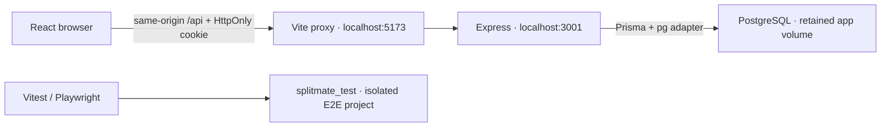

# Architecture and engineering decisions

SplitMate is a monorepo with separate local-development and prepared production profiles. React/TypeScript/Vite renders the existing green-and-cream interface; Vite proxies same-origin /api requests to Express. PostgreSQL is authoritative for users, sessions, memberships, expense shares, settlements, invitations and activity.

## Request and permission boundaries

Every mutation requires the exact configured Origin and JSON content type. Protected routes resolve an opaque random session cookie through its SHA-256 database hash, enforce its absolute expiry, and require a separate session CSRF token on writes. Personal analytics and dashboard totals derive their actor ID from the resolved session; query/body user IDs cannot select another person's personal totals.

Membership checks scope each group read. Nonmembers receive 404 rather than group details. Expense payer and participants must be current members; expense edits require recorder or owner, and a matching version. Repayment recording requires a participant in that repayment or the owner; reversal requires recorder or owner. Invitation acceptance/decline is restricted to the registered recipient.

Phase 6 retires direct POST /groups/:id/members with 410 for owners. It never grants membership; use invitations and explicit recipient acceptance. Existing memberships/data are retained. This closes the previous immediate-add consent gap.

## Financial model

All monetary input is integer minor units, with a per-record PostgreSQL Int maximum of 2,147,483,647. Decimal UI input is parsed as text. Equal and percentage splits use integer/BigInt arithmetic and deterministic UUID tie-breaking; percentages are basis points. Exact shares must sum exactly; percentage weights must sum to 10,000.

Aggregate arithmetic uses BigInt and rejects JSON totals beyond JavaScript's safe integer range. Each member net is paid minus expense share plus repayments sent minus repayments received. Reversed repayments remain recorded but contribute zero. The server independently reconciles the direct-debt graph against every member's net, and simplification requires zero-sum balances.

Opposite debts are netted per pair. Optional group-wide suggestions greedily match largest debtors and creditors with stable ties. They preserve every net and exclude zero-balance members; they do not rewrite expense shares and are not guaranteed to minimize the number of repayments. Bilateral cycles can remain after group-wide repayment even when member nets are zero. Currency totals are separate; no exchange conversion is performed.

## Transactions and audit

Financial writes use serializable transactions and a per-group PostgreSQL row lock. Expense and repayment creation use durable actor-scoped idempotency keys plus request hashes. A replay of the same normalized request returns the existing record; a conflicting body returns 409. Serializable/unique conflicts are retried within bounded loops where supported; exhausted conflicts ask the client to refresh/retry. Expense version conflicts prevent lost updates. Reversal has one durable append-only record per original repayment.

Expense/share changes, activity and notification creation commit together. A failed audit insertion rolls back its financial write. Append-only activity uses a database trigger. Actor names and reference UUIDs are snapshots without actor/group foreign keys, so audit evidence can survive deletion of an empty group. Current membership still governs read access. Audit tracking began in Phase 5; no historical actors or edits are fabricated. A database owner can disable triggers; this is an application/database invariant, not cryptographic tamper evidence.

The live server and integration tests share one database-client factory. Connection acquisition and server-side statements have 10-second limits; interactive transactions allow 10 seconds to acquire and 15 seconds to execute. Server-side statement cancellation replaces the former 3-second client query timer. An integration test verifies the configured statement timeout and rollback after PostgreSQL cancels a statement. These budgets bound work; they are not a throughput or latency guarantee. See the [node-postgres client configuration](https://node-postgres.com/apis/client) for the distinction between statement and client query timeouts.

## Security review

Passwords use Node scrypt with random salts, N=32768, r=8, p=3, a fixed validated format, bounded hashing concurrency and timing-safe verification. This is one of the parameter combinations listed in [OWASP password storage guidance](https://cheatsheetseries.owasp.org/cheatsheets/Password_Storage_Cheat_Sheet.html#scrypt). Unknown-account login performs a dummy derivation; wrong/unknown credentials return the same error. Registration still reveals duplicate email through 409, an intentional local usability tradeoff.

Session cookies are HttpOnly and SameSite=Strict, with a seven-day absolute lifetime. Login rotates the current browser's session and logout revokes that database session. Secure cookies are disabled only for local HTTP; production-mode startup requires HTTPS origin and secure cookies. There is no password reset, MFA, idle timeout or UI to revoke all devices.

Authentication requests are limited to 20 per 15 minutes per observed IP. Phase 6 adds 120 authenticated writes per minute per user, preserving logout access. Both limiters bound in-memory key counts and expire windows; Retry-After reflects the configured window. They reset on process restart and are not a distributed limiter. Local Express does not trust forwarding headers; the prepared Render profile explicitly trusts only the nearest ingress hop; Docker/Vite can aggregate clients under a proxy IP. Configure a trusted ingress and shared limiting store before multi-instance deployment. Read traffic is not separately throttled.

Input allowlists, parameterized Prisma queries, bounded JSON bodies and safe response projections reduce injection/overposting/data-leak risks. React escapes text, and no raw HTML rendering is used. Responses prevent MIME sniffing and cache authenticated API data with no-store. Unexpected server errors log only the method, route template, safe error code/type and timeout flag; raw messages, SQL, bodies, credentials and stack traces are excluded. This is a source/test review, not a penetration test.

## Operational limitations and readiness

This delivery does **not** establish production readiness. The local Compose frontend still uses Vite's development server; the separate production profile uses Express static serving. Runtime images contain build/development tools and use the base image's default user. Internet-facing deployment still needs a static frontend/reverse proxy, TLS/security headers (including a suitable CSP), least-privilege database/runtime identities, secret management, distributed abuse controls, operational logging/metrics, backup/restore drills, retention/privacy policy and load testing.

Balances and analytics still load full group ledgers; only expense/activity/notification history is paginated. Scale and resource limits have not been benchmarked. Docker health checks are connectivity checks, not proof of application correctness. Browser tests cover Chromium; Firefox/WebKit, screen-reader review and exhaustive keyboard testing remain manual work.

No Phase 6 database change is required: the existing six migrations cover the unchanged schema. No reset, historical rewrite or seed of the application database is performed.

## Prepared production profile

NODE_ENV=production serves the compiled frontend through Express with CSP, HSTS and frame restrictions. /api remains reserved for JSON responses; extensionless browser GET/HEAD routes receive the SPA shell, while missing assets and API paths do not. /healthz is database-free liveness; /api/health is DB readiness. The server binds to 0.0.0.0 by default in production and honors PORT. Render terminates HTTPS and TRUST_PROXY=1 is explicit. Local Compose remains separate.

Sessions remain PostgreSQL-backed across app instances. Runtime Neon connections use verified TLS and a bounded pg pool; migrations use an explicit direct URL. Pooled Neon omits session SQL timeout assumptions; local/direct connections retain the ten-second SQL limit. See [deployment](deployment.md) for settings, free-tier boundaries and unverified cloud checks.

Client generation now uses a separate connection-free Prisma config. Render builds and startup need only the pooled runtime URL. Migration CLI commands retain the explicit direct config and require a separately approved operation. npm start and start:render do not migrate, seed or persist anything to the service filesystem. See deployment.md for exact dashboard values and the liveness/readiness distinction.
